<div align="center">

<a href="https://msreeganeshnaik.github.io/chandrayaan-anatomy/"><picture><source media="(prefers-color-scheme: dark)" srcset="docs/images/chandrayaan-hindi-dark.png" />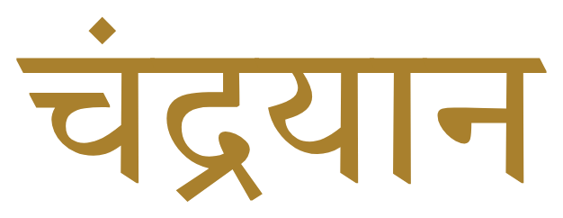</picture></a>

# Chandrayaan Anatomy

**Chandrayaan-1 &nbsp;·&nbsp; Chandrayaan-2 &nbsp;·&nbsp; Chandrayaan-3 &nbsp;·&nbsp; PSLV-XL &nbsp;·&nbsp; LVM3**

An interactive 3D technical drawing of India's three missions to the Moon, and the rockets that launched them.<br />
Take every spacecraft and rocket apart, fire every engine, replay Vikram's two descents, and follow all three journeys on a to-scale map of the Earth and Moon.

[](https://msreeganeshnaik.github.io/chandrayaan-anatomy/)

[](https://threejs.org/)
[](https://www.khronos.org/webgl/)
[](dist/chandrayaan.html)
[](#how-it-is-built)
[](#sources)
[](LICENSE)

[**Live demo**](https://msreeganeshnaik.github.io/chandrayaan-anatomy/) &nbsp;·&nbsp; [Tour](#the-tour) &nbsp;·&nbsp; [The film](#the-film) &nbsp;·&nbsp; [What's inside](#whats-inside) &nbsp;·&nbsp; [Run it](#run-it) &nbsp;·&nbsp; [How it's built](#how-it-is-built) &nbsp;·&nbsp; [The missions](#chandrayaan-everything-you-need-to-know) &nbsp;·&nbsp; [Sources](#sources)

<br />

<a href="https://msreeganeshnaik.github.io/chandrayaan-anatomy/">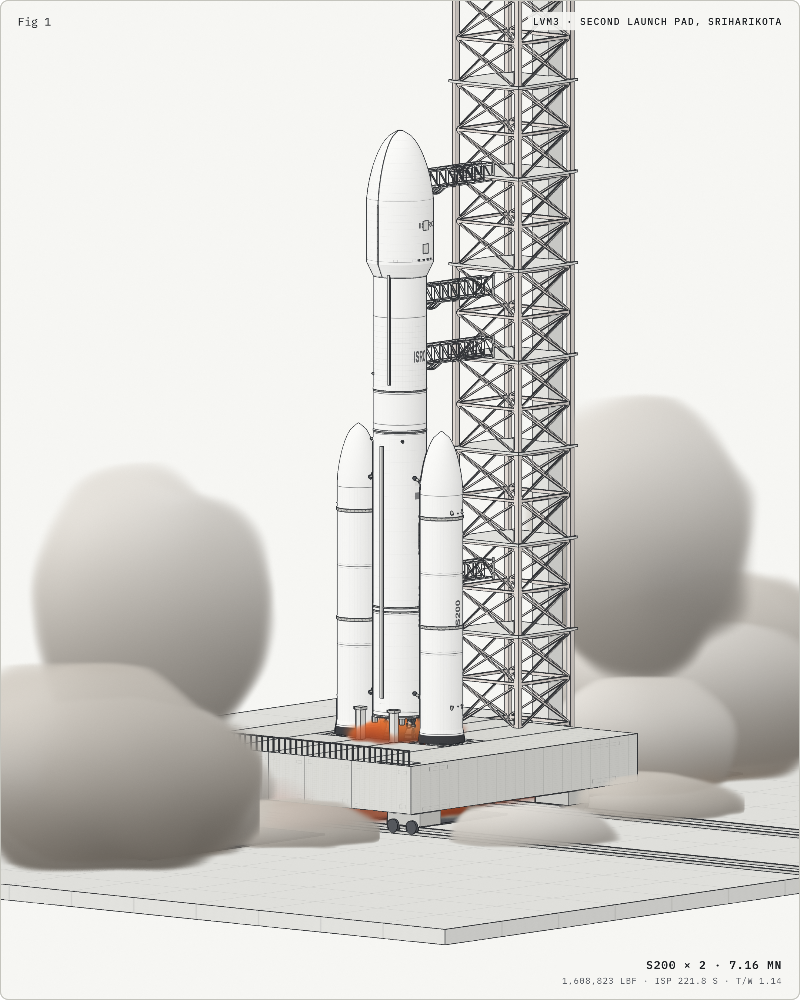</a>

<sub>LVM3 on the Second Launch Pad with both S200 boosters lit. The exhaust goes down through the deck, onto the flame deflector and out through the ducts, where it rolls out across the pad.</sub>

</div>

<br />

## The tour

<table>
<tr>
<td width="50%" valign="top">
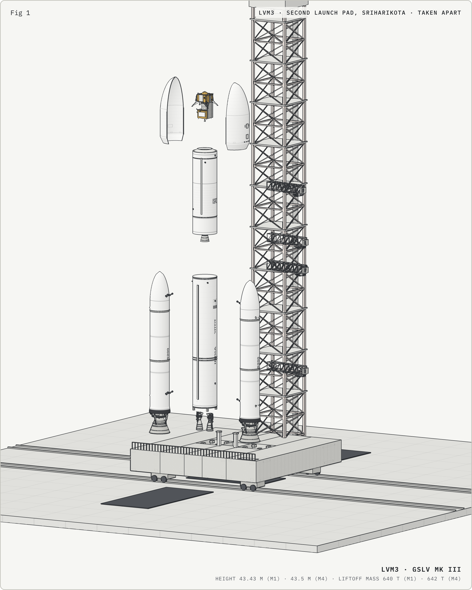
<p><b>Take LVM3 apart.</b> Both S200 boosters, the L110 core with its two Vikas engines, the C25 cryogenic stage, the fairing halves and Chandrayaan-3 itself open out in the order they flew. Fire any stage while it's apart and it climbs clear of the platform.</p>
</td>
<td width="50%" valign="top">
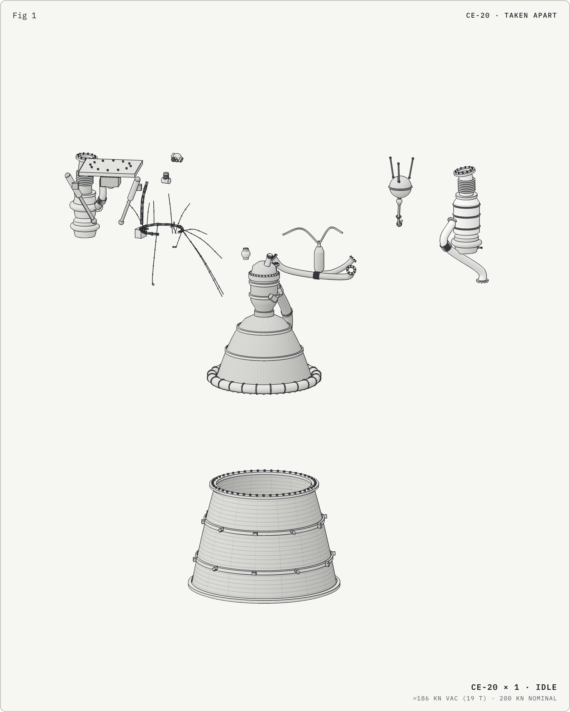
<p><b>Every engine, down to its turbopumps.</b> The CE-20 separates into its nozzle extension, thrust chamber, the liquid-hydrogen and liquid-oxygen turbopumps, gas generator, start-up system, main valves and gimbal. Click any assembly to read what it does.</p>
</td>
</tr>
<tr>
<td colspan="2" valign="top">
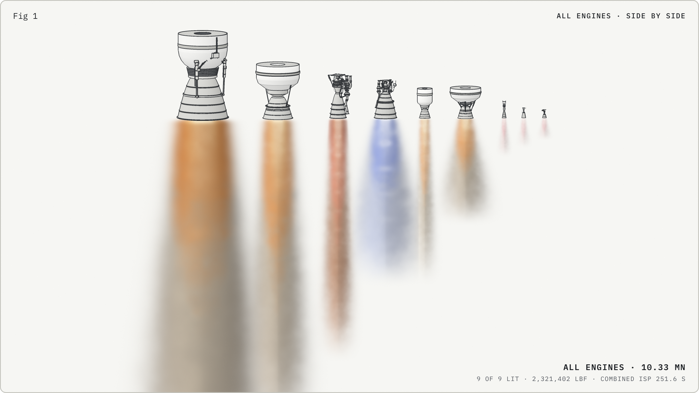
<p><b>All nine engines, side by side, at true relative scale.</b> S200, S139, Vikas, CE-20, PSOM-XL, HPS3, PS4, the 440 N apogee motor and Vikram's 800 N engine, exits on one line. Light them all, or one at a time; the readout adds up thrust and mass flow from each engine's own ratings.</p>
</td>
</tr>
<tr>
<td width="50%" valign="top">
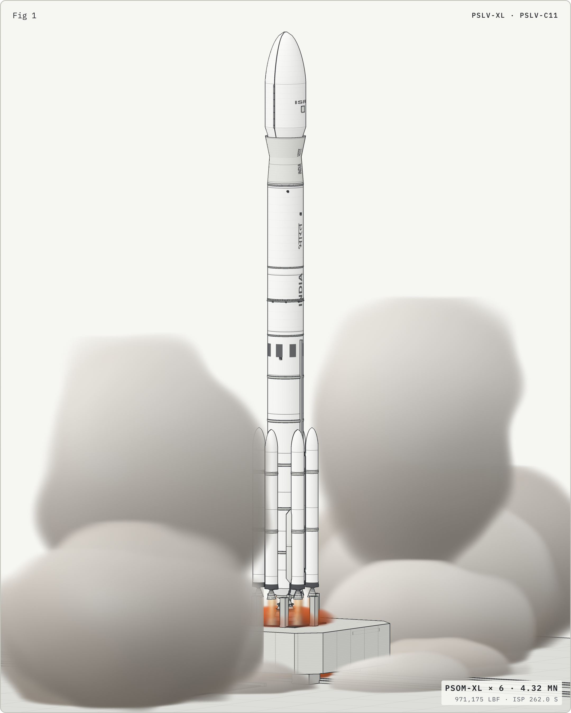
<p><b>Light the PSOM-XLs.</b> Six boosters at 720 kN each. On PSLV-C11, on 22 Oct 2008, four lit on the ground at T+0.4 s, just after the core, and two in the air at T+25 s; cut any of them to see the share each one carries.</p>
</td>
<td width="50%" valign="top">
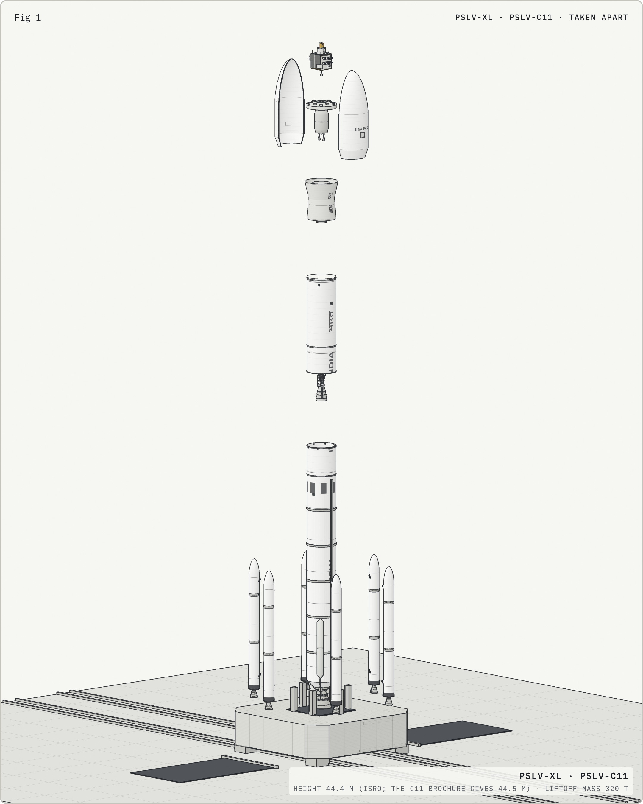
<p><b>Then take it apart.</b> All six boosters come away first, then PS2 with its Vikas, the solid PS3, the twin-engined PS4, the heat shield and Chandrayaan-1.</p>
</td>
</tr>
<tr>
<td width="50%" valign="top">
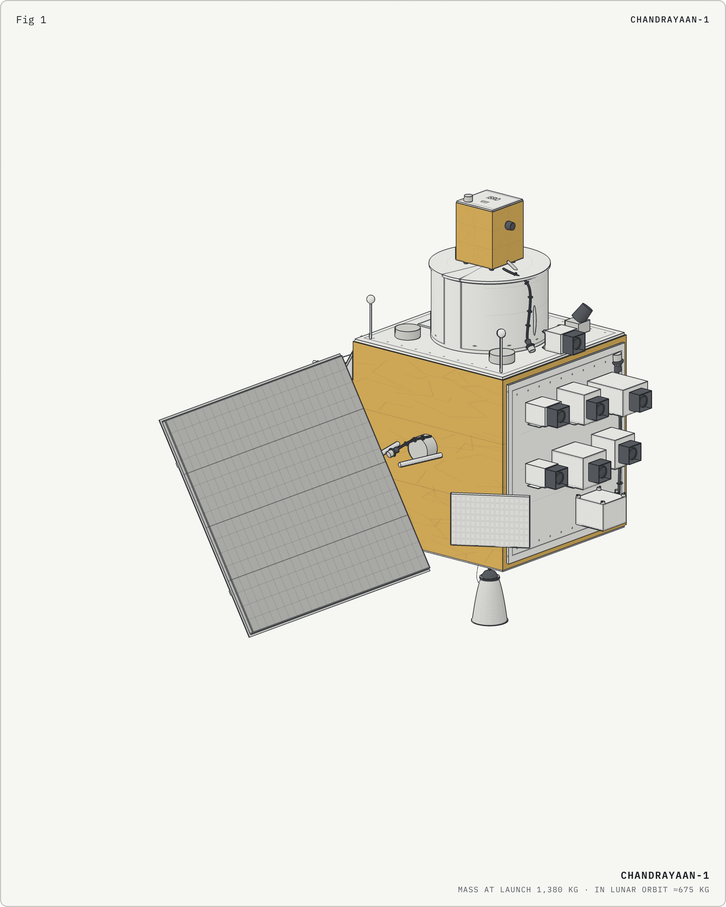
<p><b>Chandrayaan-1.</b> A 1.5 m cube built on the IRS bus, with eleven instruments from India, the USA, Europe and Bulgaria. Its NASA-built M³ found the spectral signature of water on the Moon's surface; the Moon Impact Probe on top hit near Shackleton crater.</p>
</td>
<td width="50%" valign="top">
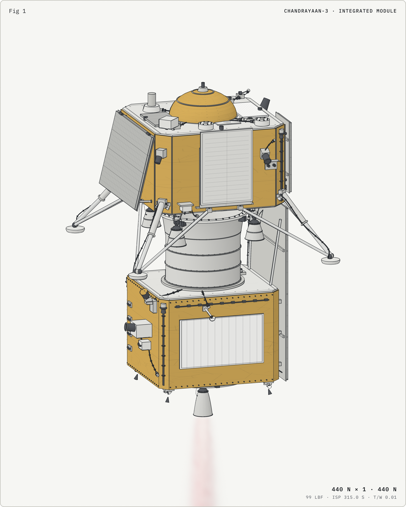
<p><b>Chandrayaan-3, as it flew.</b> Vikram rides stowed on the propulsion module, whose 440 N engine did every burn from Earth orbit to lunar orbit. Fire it here and the readout gives its thrust from the rated Isp.</p>
</td>
</tr>
<tr>
<td width="50%" valign="top">
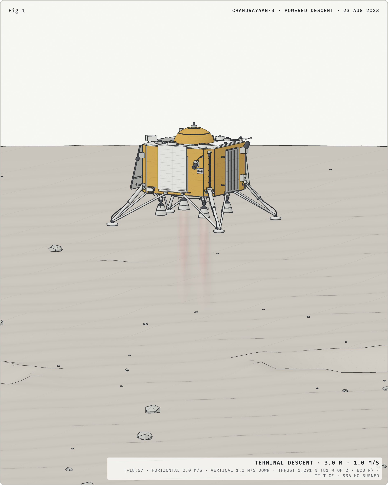
<p><b>Replay the landing.</b> Chandrayaan-3's descent from 30 km, at ISRO's published altitudes and speeds: four engines to the 800 m hover, two for the last 800 m, touchdown at 18:03 IST. Playback runs fast up high and in real time near the ground.</p>
</td>
<td width="50%" valign="top">
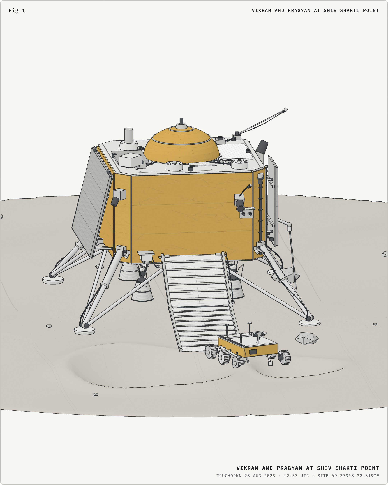
<p><b>Vikram and Pragyan at Shiv Shakti.</b> The lander with its ramp down and the six-wheeled rover on the regolith, ILSA, RAMBHA-LP, ChaSTE and NASA's laser retroreflector each with a sheet of its own.</p>
</td>
</tr>
<tr>
<td colspan="2" valign="top">
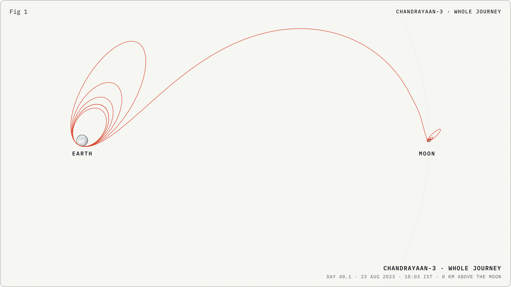
<p><b>All three journeys, to scale.</b> The Earth, the Moon and the distance between them at true scale, with each mission's orbit-raising burns, trans-lunar injection, lunar orbit insertion and descent on its own track. <i>Previous / Next</i> steps through every burn, with the date, the time in IST and the distance.</p>
</td>
</tr>
</table>

<details>
<summary><b>More: Vikas firing, Chandrayaan-2, Chandrayaan-3 apart and the 2019 descent</b></summary>
<br />
<table>
<tr>
<td width="50%" valign="top">
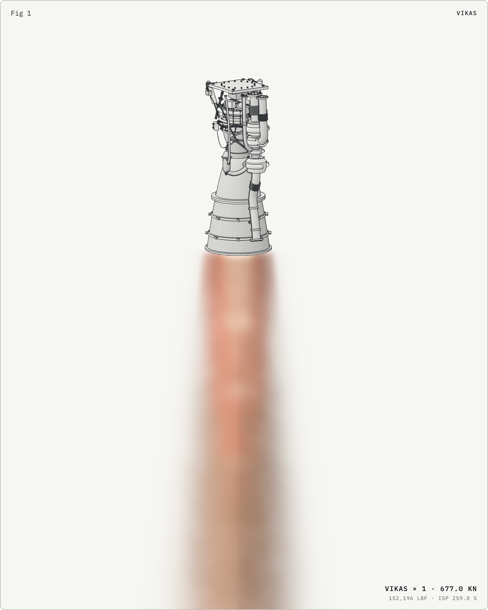
<p><b>Vikas, firing.</b> The engine that drives PSLV's second stage and, in a pair, the L110 core of LVM3. UH25 and nitrogen tetroxide burn orange-red, with a darker edge.</p>
</td>
<td width="50%" valign="top">
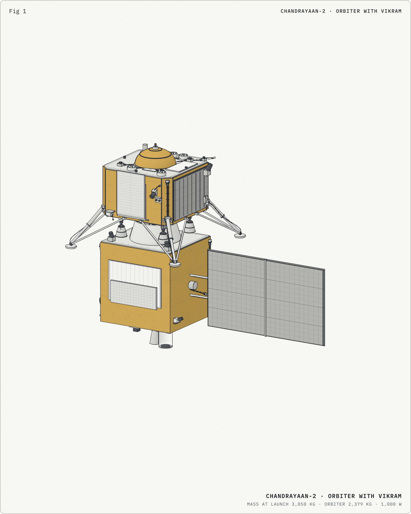
<p><b>Chandrayaan-2.</b> The orbiter, which went on to map the Moon from a 100 km polar orbit, with the first Vikram on top.</p>
</td>
</tr>
<tr>
<td width="50%" valign="top">
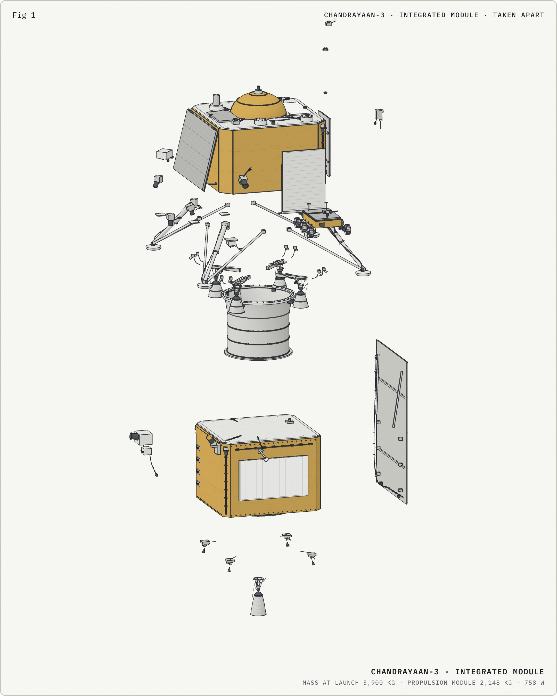
<p><b>Chandrayaan-3 apart.</b> Vikram, the inter-module adapter and the propulsion module, each with its own parts.</p>
</td>
<td width="50%" valign="top">
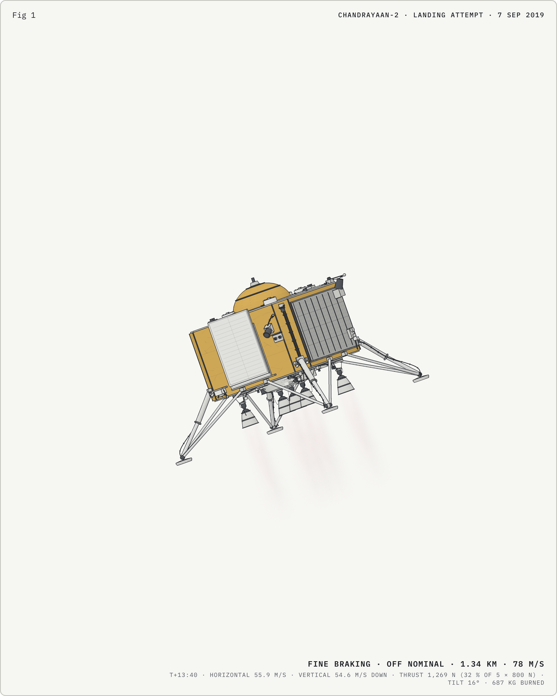
<p><b>7 Sep 2019.</b> The first Vikram, five engines lit, in the replay of a descent that was normal down to 2.1 km and lost about 330 m above the surface.</p>
</td>
</tr>
</table>
</details>

---

## The film

<a href="docs/film/chandrayaan-anatomy-film.mp4">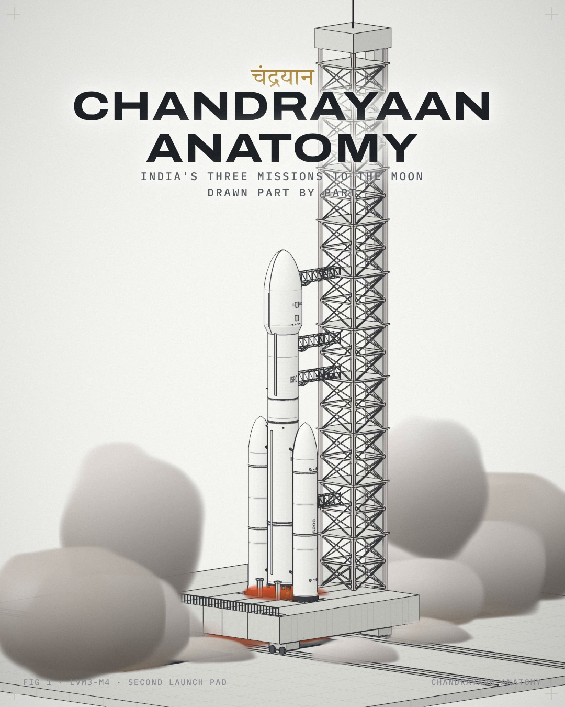</a>

A 66-second launch film made entirely from the page. [**Watch it**](docs/film/chandrayaan-anatomy-film.mp4) (1080 × 1350, 60 fps, 50 MB).

It tells the three missions in three acts: 2008, 2019 (the signal lost about 330 m above the Moon) and 2023 ("So we went back", touchdown at 18:03 IST).

- **Picture.** Every shot is the page itself, rendered frame by frame on an Apple M4 Pro GPU through a capture build ([`capture/90-capture.js`](capture/90-capture.js)).
  - Each frame is drawn at 3240 × 4050 (1.5× supersampling with 4× MSAA on a 2160 × 2700 canvas).
  - Three sub-frames are averaged in linear light for motion blur, then the frame is box-filtered to 1080 × 1350.
  - The GPU's own H.264 encoder writes the result through WebCodecs.
  - All twelve shots took about three and a half minutes.
- **Titles, edit and grade** are in [`film/`](film/): a Chromium-drawn title layer, the cut list, and a hairline drawing-sheet border on every frame.
- **Sound.** The score, the sound effects and the mix are synthesised in Python on one 120 BPM grid: organ, strings, brass, a ticking clock, Shepard-tone risers, ignition rumble and telemetry blips.
- **Narration.** Spoken by [Kokoro](https://github.com/thewh1teagle/kokoro-onnx), an open-source text-to-speech model (Apache-2.0), and checked line by line by transcription with faster-whisper.

The script, storyboard and beat grid are in [`film/PLAN.md`](film/PLAN.md).

---

## What's inside

| Section | What's in it |
|---|---|
| **Overview** | LVM3 on the Second Launch Pad, PSLV-XL as PSLV-C11, Chandrayaan-1, Chandrayaan-2 (orbiter with Vikram), Chandrayaan-3 (the integrated module), and Vikram and Pragyan on the Moon. |
| **LVM3 stages** | Both S200 boosters, the L110 core with two Vikas, the C25 cryogenic stage with the CE-20, the 5 m ogive fairing, Chandrayaan-3 stowed, and the launch pedestal with its umbilical tower. *Take apart* opens the stack in staging order. |
| **PSLV-XL stages** | Six PSOM-XL boosters (four ground-lit, two air-lit), the S139 core, PS2 with its Vikas, the solid PS3, the twin-engined PS4, the heat shield and Chandrayaan-1 stowed. |
| **Engines** | Five engines built down to their assemblies (Vikas, CE-20, the S200 flex nozzle, the 440 N apogee motor and Vikram's 800 N throttleable engine), each taken apart and fired on its own; and all nine engine types side by side at true relative scale. |
| **Chandrayaan-1** | The bus, solar wing and antenna; the 440 N engine; the Moon Impact Probe; and the other ten instruments: TMC, HySI, LLRI, HEX, M³, Mini-SAR, C1XS, SIR-2, SARA and RADOM. |
| **Chandrayaan-2** | The orbiter, its 440 N engine and eight instruments (OHRC, TMC-2, IIRS, DFSAR, CLASS, XSM, CHACE-2, DFRS), and the first Vikram with its five engines. |
| **Chandrayaan-3** | The propulsion module with its 440 N engine, eight 22 N thrusters and SHAPE; the inter-module adapter; and Vikram stowed for the trip. |
| **Vikram & Pragyan** | The four 800 N engines, the lander body, solar panels, legs, landing sensors and the two-segment ramp; Pragyan; ChaSTE, ILSA, RAMBHA-LP and the laser retroreflector. |
| **The landings** | The 2023 landing, the 2019 attempt and the 3 Sep 2023 hop, each replayed with live altitude, speeds, engine count and thrust. |
| **The journey** | All three missions, burn by burn, on a to-scale map of the Earth and Moon, from launch to lunar orbit and down to the surface; and Chandrayaan-3's propulsion module on its way back to Earth orbit. |

**Live numbers.** Every figure on the propulsion console is computed. Thrust follows F = t·F<sub>vac</sub> − p<sub>a</sub>·A<sub>e</sub>, with the ambient pressure from the U.S. Standard Atmosphere 1976 and each exit area from its engine's rated sea-level and vacuum pair. Solids burn to the end once lit; the liquids take a throttle and an engine-out toggle.

**Plume colours follow the propellants:**
- the S200, S139, PSOM-XL and HPS3 solids burn HTPB: a bright yellow-orange core trailing into pale smoke;
- Vikas burns UH25 with nitrogen tetroxide: orange-red, with a darker, sooty edge;
- the CE-20 burns liquid hydrogen with liquid oxygen: almost clear, a faint blue;
- the PS4, the 440 N motor and Vikram's 800 N engines burn MMH with MON-3: a translucent rose-orange.

<details>
<summary><b>Camera controls</b></summary>
<br />

Turn on *Free cam*, then:

| Input | Action |
|---|---|
| Drag | orbit (or pan, set by the Drag toggle) |
| Right- or Shift-drag | pan |
| Scroll / pinch | zoom |
| W / S, A / D, Q / E | fly in-out, sideways, down-up (Shift = faster) |
| Arrow keys | turn and tilt |
| R | reset the view |
| Space / Enter | ignite / shut down the selected engines |

</details>

---

## Run it

**Just view it:** go to the [live site](https://msreeganeshnaik.github.io/chandrayaan-anatomy/), or download [`dist/chandrayaan.html`](dist/chandrayaan.html) and open it in a current Chrome, Edge, Safari or Firefox. It needs an internet connection the first time, to load three.js and the fonts from their CDNs, and it needs WebGL 2; with WebGL off, the specification sheets still load.

**Serve it locally** (some browsers restrict module scripts on `file://`):

```bash
python3 -m http.server 8000
# then open http://localhost:8000/dist/chandrayaan.html
```

**Build from source.** `dist/chandrayaan.html` is generated; edit `src/` and rebuild:

```bash
npm install
npm run build          # src/ → dist/chandrayaan.html
```

<details>
<summary><b>Headless screenshots, scripting, the film rig, hosting</b></summary>
<br />

Playwright runs the page in Chromium with the SwiftShader software renderer, so it behaves the same on any machine, GPU or not. It maps the three.js CDN to `node_modules`.

```bash
npx playwright install chromium   # once
npm run shot -- demo '[["wait",6000],["eval","CH.selectItem(\"stack\"); CH.ignite(); CH.warp(3)"],["el","ignition","#fig"]]' --dpr=2
# → shots/demo-ignition.png
```

Flags: `--w=1400 --h=1000` set the viewport, `--mobile` uses a 390 × 844 phone, `--dark` forces the dark scheme, `--noaa` turns anti-aliasing off (much faster in software rendering) and `--dpr=2` sets the pixel ratio.

The page exposes `window.CH` (also `window.CHANDRAYAAN`) for scripting:
- **actions:** `selectItem(id)`, `ignite()`, `shutdown()`, `fireOne(i)`, `setExplode(on)`, `warp(seconds)`, `zoomBy(f)`, `orbitBy(dx, dy)`, `resetView()`, `descentRun(run)`, `descentPlay()`, `descentScrub(f)`;
- **state:** `MENU_ITEMS`, `SHOW`, `C`, `CAM`, `J`, `DS`, `ENGINE_SETS`, `groupState()`.

**The film rig.** `npm run build:capture` writes `dist/capture.html`: the same page plus a capture panel. Opened on a real GPU, it renders each shot of the film deterministically and encodes it with WebCodecs. *README stills* renders the screenshots in this README at 2160 px. The shots are defined in [`capture/90-capture.js`](capture/90-capture.js).

**Hosting.** GitHub Pages serves the `gh-pages` branch, which holds only the built page: `index.html`, a copy as `chandrayaan.html`, and `.nojekyll`. After changing `main`, publish with `npm run deploy`.

</details>

---

## How it is built

`scripts/build.mjs` concatenates every `src/**/NN-*.js`, in NN order, into one ES module. It inlines `src/page/style.css` and `src/page/body.html` and writes one standalone page, `dist/chandrayaan.html`. three.js r160 is imported straight from jsDelivr. There are no frameworks and no other runtime dependencies.

```text
chandrayaan-anatomy/
├── dist/
│   └── chandrayaan.html       the built page: one file, open it and it runs
├── src/
│   ├── page/                  style.css · body.html
│   ├── core/                  00-head · 05-util · 20-render · 30-geom · 42-showkit
│   ├── data/                  05-land · 10-data · 11-craft-data · 12-launch · 13-missions · 15-menu
│   ├── models/                41-craft · 41-detail · 42-launchkit · 43-lvm3 · 44-padfx · 45-pslv
│   ├── scenes/                44-show · 45-engines · 46-lineup · 47-journey · 48-descent
│   └── app/                   50-controller · 60-ui · 65-sheets · 70-main
├── capture/                   90-capture.js: the GPU film and stills rig (capture build only)
├── film/                      the launch film: plan, title layer, score, narration, edit
├── scripts/                   build.mjs · shot.mjs · deploy.sh
├── docs/
│   ├── images/                chandrayaan-hindi-light.png · chandrayaan-hindi-dark.png · screenshots/
│   └── film/                  chandrayaan-anatomy-film.mp4 · poster.jpg
├── package.json
├── LICENSE
└── README.md
```

| File | Role |
|---|---|
| `src/core/00-head.js` | three.js import, maths helpers |
| `src/core/05-util.js` | DOM shortcuts, number formatting, seeded random, stripe textures |
| `src/core/20-render.js` | The technical-illustration pipeline, toon materials, procedural canvas textures, and the volumetric exhaust shader with its colour sets |
| `src/core/30-geom.js` | Geometry kit: lathe profiles, rods, trusses, modules |
| `src/core/42-showkit.js` | Helpers for detailed parts: merged geometry, ducts, cables, bolt circles, flanges |
| `src/data/05-land.js` | Coastlines for the globe (Natural Earth 1:110m) |
| `src/data/10-data.js` | Constants, the U.S. Standard Atmosphere 1976, the page's sources |
| `src/data/11-craft-data.js` | **The spacecraft's numbers.** Chandrayaan-1, 2 and 3, Vikram, Pragyan, every instrument sheet |
| `src/data/12-launch.js` | **The launch vehicles' numbers.** LVM3 and PSLV-XL geometry, stage and engine ratings, the pad |
| `src/data/13-missions.js` | **The missions' numbers.** Every burn and orbit, both descents and the hop |
| `src/data/15-menu.js` | The parts index: which parts each item frames, and the order the sections read in |
| `src/models/41-craft.js` · `41-detail.js` | Chandrayaan-1, the Chandrayaan-2 orbiter, the propulsion module, Vikram (both versions) and Pragyan, part by part |
| `src/models/42-launchkit.js` | Shared launcher parts: liquid stages, solid motors, fairings, interstages |
| `src/models/43-lvm3.js` | LVM3 on the Second Launch Pad: the stack, the pedestal, the umbilical tower and its arms |
| `src/models/44-padfx.js` | Pad exhaust: deflector flame, duct fire, billowing clouds, the ring of smoke round the pedestal |
| `src/models/45-pslv.js` | PSLV-XL as PSLV-C11, its six boosters and its pad |
| `src/scenes/44-show.js` | Registers the displays and their take-apart vectors |
| `src/scenes/45-engines.js` | **The detailed engines:** Vikas, CE-20, the S200 nozzle, the 440 N and 800 N engines |
| `src/scenes/46-lineup.js` | All nine engines side by side at true relative scale |
| `src/scenes/47-journey.js` | **The journeys:** the to-scale Earth–Moon map, every burn, the globe and the labels |
| `src/scenes/48-descent.js` | **The landings:** descent model, terrain, dust and the replay controls |
| `src/app/50-controller.js` | State, engine physics per frame, take-apart and staging poses, camera framing |
| `src/app/60-ui.js` | Parts index, figure overlays, propulsion console, throttle |
| `src/app/65-sheets.js` | Spec sheets, the engines table and its maths, the mission records, the sources |
| `src/app/70-main.js` | Boot, picking, the frame loop |
| `capture/90-capture.js` | The film rig: deterministic clock, scripted shots, supersampled motion-blurred frames, WebCodecs encode, the README stills |
| `film/` | `PLAN.md` (script and storyboard), `overlay/overlay.html` (title layer), `scripts/score.py` (score, effects, mix), `scripts/gen_vo.py` (Kokoro narration), `scripts/compose.py` (edit and encode) |

The two-digit prefixes set the order the parts are joined in, so a file can move between folders without changing the build.

<details>
<summary><b>Rendering pipeline</b></summary>
<br />

1. **Normals, part id and depth.** One pass draws every visible part's surface normal, part id and depth into a render target.
2. **Colour.** A second pass draws the paper-tone "toon" colour with 4× MSAA.
3. **Ink.** A composite pass draws the ink lines wherever the normal bends sharply, the part id changes or the depth jumps. The result reads like an inked technical drawing rather than a shaded model.
4. **Exhaust and overlays.** Plumes, pad fire, exhaust clouds and lunar dust are raymarched volumes, stopped by the scene depth so nozzles, decks and the ground hide them correctly. The journey's tracks are screen-space ribbons drawn in the same pass.

**Anti-aliasing.** With it on, the scene renders at up to 2× the device resolution within a pixel budget and is box-filtered down. The budget is 10 MP on desktops and 16 MP on phones and tablets.

**Smoothness.** Frames are skipped when nothing on screen can have changed, only the selected display is drawn, and the journey map is built in idle time after the page loads.

</details>

<details>
<summary><b>Physics and orbits</b></summary>
<br />

- **Thrust:** F(t, p<sub>a</sub>) = t · F<sub>vac</sub> − p<sub>a</sub> · A<sub>e</sub>. Momentum thrust scales with mass flow; the pressure term does not.
- **Exit area** comes from each engine's rated pair: for Vikas, A<sub>e</sub> = (766 − 677) kN ÷ 101,325 Pa ≈ 0.88 m², an exit about 1.06 m across.
- **S200 vacuum thrust** isn't rated, so it follows from the 3.27 m exit: 3,578 kN average at sea level plus p<sub>0</sub> · A<sub>e</sub> ≈ 4,430 kN. The published Isp pair would give about 4,330 kN; the page shows the disagreement.
- **Liftoff thrust-to-weight** is worked out from each stack's rated thrust and liftoff mass.
- **Ambient pressure** comes from the U.S. Standard Atmosphere 1976, seven layers to 86 km, with vacuum above.
- **The journeys:** each mission's orbits are built from the published perigee and apogee after every burn, joined at the burn dates, and drawn at true scale against the Earth and the Moon's mean distance.
- **The descents:** altitude and vertical speed run on smooth curves through ISRO's published waypoints; mass falls with the propellant burned at the rated Isp, and the lit engines share the thrust needed.

</details>

---

## Chandrayaan: everything you need to know

*Chandrayaan* means "Moon craft" in Sanskrit. Three missions, flown by the Indian Space Research Organisation (ISRO), took India from its first lunar orbiter in 2008 to a soft landing near the Moon's south pole in 2023, with a hard lesson in between.

### At a glance

| | Chandrayaan-1 | Chandrayaan-2 | Chandrayaan-3 |
|---|---|---|---|
| Launch | 22 Oct 2008, 06:22 IST | 22 Jul 2019, 14:43:12 IST | 14 Jul 2023, 14:35:17 IST |
| Rocket and pad | PSLV-C11 (PSLV-XL), Second Launch Pad, Sriharikota | GSLV Mk III-M1 (LVM3), Second Launch Pad | LVM3-M4, Second Launch Pad |
| Spacecraft | 1,380 kg orbiter with a 35 kg Moon Impact Probe | 3,850 kg: orbiter 2,379 kg, Vikram 1,471 kg with Pragyan | 3,900 kg: propulsion module 2,148 kg, Vikram 1,752 kg with Pragyan |
| Into lunar orbit | 8 Nov 2008 | 20 Aug 2019 | 5 Aug 2023 |
| At the surface | Moon Impact Probe hit near Shackleton crater, 14 Nov 2008 | Vikram lost during its descent, 7 Sep 2019 | Vikram landed at 18:03 IST, 23 Aug 2023, 69.373°S 32.319°E |
| After that | Contact lost 29 Aug 2009, after 312 days | The orbiter carried on in a 100 km polar orbit; ISRO put its life at nearly seven years | Lander and rover put to sleep on 4 and 2 Sep 2023; the propulsion module was sent back to Earth orbit |

### The rockets, stage by stage

**LVM3 (GSLV Mk III)**, 43.5 m and about 640 t at liftoff, 4.0 m core:

| Stage | Built by | Key figures |
|---|---|---|
| **2 × S200** | VSSC | 26.22 m × 3.2 m, 204.5 t of HTPB each, three segments. Average 3,578 kN at sea level, peak near 5,151 kN; burn about 130 s. Steered by a flex nozzle. Both light on the pad and lift the vehicle alone |
| **L110 core** | LPSC | 21.4 m × 4.0 m, 115.8 t of UH25 and N₂O₄. Two Vikas engines, air-lit at T+108 s while the S200s still burn |
| **C25 cryogenic stage** | LPSC | 13.5 m × 4.0 m, 28.6 t of liquid hydrogen and oxygen. One CE-20, which burned 646.5 s on LVM3-M4 |
| **Payload fairing** | | 5 m ogive |

**PSLV-XL, as PSLV-C11**, 44.4 m and 320 t at liftoff, 2.8 m core:

| Stage | Key figures |
|---|---|
| **6 × PSOM-XL** | 12.4 m × 1.0 m, 12 t of HTPB each, 720 kN maximum. Four lit on the ground at T+0.4 s, two in the air at T+25 s. C11 was their first flight |
| **PS1 (S139)** | 20.2 m × 2.8 m, 138 t of HTPB, 4,910 kN maximum, 98 s |
| **PS2** | 11.9 m × 2.8 m, 41.5 t of UH25 and N₂O₄. One Vikas, 800 kN, 147 s |
| **PS3 (HPS3)** | 3.6 m × 2.0 m, 7.6 t of HTPB, 246 kN, 107.6 s, flex nozzle |
| **PS4** | 2.9 m × 2.8 m, 2.5 t of MMH and MON-3. Two 7.31 kN engines, rated for 525 s |

### The engines

| Engine | Where | Thrust | Isp (s) | Propellants | Notes |
|---|---|---|---|---|---|
| **S200** | LVM3 boosters | 3,578 kN SL average | 227 SL · 274.5 vac | HTPB solid | Flex nozzle, 3.27 m exit, about 130 s |
| **Vikas** | L110 (×2), PSLV PS2 | 677 kN SL · 766 kN vac (L110); 800 kN (PS2) | 293 vac | UH25 / N₂O₄ | Turbopump-fed, radiation cooled (LPSC); descended from the Viking |
| **CE-20** | C25 | ≈186 kN vac (19 t), 200 kN nominal | 442 | LH₂ / LOX | Gas-generator cycle, 60 bar, mixture 5.05 : 1, expansion 100 : 1. Gimbals ±4° in two planes |
| **S139** | PSLV PS1 | 4,910 kN maximum | 237 SL · 269 vac | HTPB solid | Steered by injecting fluid into the nozzle |
| **PSOM-XL** | PSLV boosters (×6) | 720 kN maximum | 262 | HTPB solid | 49 s |
| **HPS3** | PSLV PS3 | 246 kN | 295 | HTPB solid | |
| **PS4** | PSLV PS4 (×2) | 7.31 kN | 308 | MMH / MON-3 | |
| **440 N LAM** | Chandrayaan-1, the Chandrayaan-2 orbiter, the Chandrayaan-3 propulsion module | 440 N | 315 (at ε 160) | MMH / MON-3 | Pressure-fed |
| **800 N throttleable** | Vikram (×4 on C-3; ×5 on C-2) | 800 N, down to 360 N | 315 (as drawn) | MMH / MON-3 | Throttled through its flow-control valve |

### The journeys, stage by stage

**Chandrayaan-3**, the one that landed:
1. **Launch, 14 Jul 2023.** LVM3-M4 puts the stack into a 170 × 36,500 km orbit.
2. **Five Earth-bound burns**, 15–25 Jul. Each one, fired near perigee, raises the far point of the orbit, to about 127,600 km.
3. **Trans-lunar injection, 1 Aug.** The orbit is stretched to 288 × 369,328 km, out to the Moon.
4. **Lunar orbit insertion, 5 Aug, 19:12 IST.** A 1,835 s burn captures it into a 164 × 18,074 km orbit.
5. **Lowering the orbit**, 6–16 Aug, down to 153 × 163 km.
6. **Separation, 17 Aug.** Vikram leaves the propulsion module, then de-boosts twice, down to 25 × 134 km.
7. **Landing, 23 Aug.** Powered descent from 30 km at about 17:45 IST: rough braking to 7.4 km, fine braking to about 800 m, a hover at 150 m to pick the spot, and touchdown at 18:03 IST at 0.98 m/s.
8. **The hop, 3 Sep.** Vikram fires two engines, rises about 40 cm and sets down 30–40 cm away.
9. **The propulsion module comes home.** In October and November 2023 it climbs out of lunar orbit and back into a high orbit round the Earth, with fuel to spare.

**Chandrayaan-2** followed the same pattern: five Earth-bound burns, trans-lunar injection on 14 Aug 2019, lunar orbit on 20 Aug and Vikram's separation on 2 Sep. On 7 Sep the descent was normal down to 2.1 km, by ISRO's account; live telemetry ended about 330 m up, still falling at about 58 m/s, and Vikram hard-landed within about 500 m of its target. Its impact site, found in NASA's Lunar Reconnaissance Orbiter images, is at 70.881°S 22.784°E. The orbiter carried on without it.

**Chandrayaan-1** raised its orbit five times in two weeks, reached lunar orbit on 8 Nov 2008 and settled into a 100 km polar orbit on 12 Nov. On 14 Nov it released the Moon Impact Probe, which fell for about 25 minutes and hit near Shackleton crater. It worked for 312 days, until contact was lost on 29 Aug 2009.

### Where the hardware is now

- **Chandrayaan-1:** silent in lunar orbit since 2009.
- **Chandrayaan-2 orbiter:** in a 100 km polar orbit round the Moon since September 2019; ISRO put its life at nearly seven years.
- **Chandrayaan-2's Vikram:** in pieces at 70.881°S 22.784°E.
- **Chandrayaan-3's Vikram and Pragyan:** at Statio Shiv Shakti, 69.373°S 32.319°E, asleep since early September 2023. Pragyan drove 101.4 m.
- **Chandrayaan-3's propulsion module:** in a high orbit round the Earth, swinging back past the Moon from time to time.

---

## Accuracy notes and drawing liberties

- **Numbers.** Every rated figure comes from the sources below and lives in `src/data/`. Everything derived from them (exit areas, vacuum thrusts, thrust-to-weight, ambient pressure, every orbit) is computed. About 1,035 shown claims were checked against ISRO, LPSC, NASA, ESA, JPL and the published papers in November 2026.
- **The spacecraft** are built to their published dimensions. Where ISRO publishes no size (the Chandrayaan-3 propulsion module, Vikram's leg span), parts are scaled from ISRO's photographs and CAD and say "as drawn".
- **The engines.** The parts and what they do are published (turbopumps, gas generator, start-up system, valves, gimbal); where each sits on the engine is drawn to fit.
- **The pads.** The Second Launch Pad's tower and pedestal follow published sizes where they exist; the flame deflector and ducts are representative.
- **The journeys** use the published orbit after every burn, drawn to scale. Between burns each orbit is an ellipse round one body, so the path near the Moon's sphere of influence is approximate.
- **The descents** pass through ISRO's published waypoints; between them the curves are smooth fits, not flight data.
- **Plume colours** are by propellant family.

---

## Sources

**LPSC: the engines**
- [LPSC: propulsion systems (Vikas, CE-20, 440 N LAM, 800 N throttleable engine)](https://www.lpsc.gov.in/propulsionsystems.html)
- [Development status of the CE20 cryogenic engine for GSLV Mk III (IAC-16-C4.1)](http://iafastro.directory/iac/archive/browse/IAC-16/C4/1/33734/)
- [Viking (rocket engine), Vikas's parent](https://en.wikipedia.org/wiki/Viking_(rocket_engine))

**ISRO: the missions**
- [Chandrayaan-3 mission details](https://www.isro.gov.in/Chandrayaan3_Details.html) · [Chandrayaan-3 updates](https://www.isro.gov.in/ISRO_EN/Chandrayaan3.html)
- [LVM3-M4 / Chandrayaan-3 launch brochure](https://new1.isro.gov.in/media_isro/pdf/Missions/LVM3/LVM3M4_Chandrayaan3_brochure.pdf)
- [Chandrayaan-3 lunar orbit insertion](https://www.isro.gov.in/Ch3_Lunar_Orbit_Insertion_Press_Release.html)
- [Chandrayaan-3 propulsion module moved from lunar orbit to Earth orbit](https://www.isro.gov.in/Ch3_Propulsion_Module_moved_from_Lunar_orbit_to_Earth_orbit.html) · [its lunar fly-bys](https://www.isro.gov.in/Chandrayaan_3_Fly_by.html)
- [GSLV Mk III-M1 / Chandrayaan-2 brochure](https://new1.isro.gov.in/media_isro/pdf/GSLVMkIII_M1.pdf) · [mission page](https://www.isro.gov.in/mission_GSLVMkIIIM1.html)
- [Chandrayaan-2 launch press release](https://www.isro.gov.in/ISRO_EN/Press%20Release5.html) · [trans-lunar insertion](https://www.isro.gov.in/Press%20Release4.html) · [lunar orbit insertion](https://new1.isro.gov.in/Lunar%20Orbit%20Insertion.html) · [Vikram separates](https://www.isro.gov.in/Vikram%20Lander%20successfully%20separates.html) · [de-orbiting manoeuvres](https://www.isro.gov.in/Second%20de-orbiting%20maneuver.html)
- [Chandrayaan-1 mission page](https://www.isro.gov.in/Chandrayaan_1.html)
- [PSLV-C11 mission page](https://www.isro.gov.in/mission_PSLV_C11.html) · [PSLV-C11 / Chandrayaan-1 publication](https://www.isro.gov.in/media_isro/pdf/chandrayaan/PSLV_C11_PUBLICATION.pdf)

**ISRO: the vehicles and pads**
- [LVM3 (GSLV Mk III)](https://www.isro.gov.in/GSLVmk3_CON.html) · [GSLV Mk III-D1 brochure](https://www.isro.gov.in/media_isro/pdf/Publications/Brochures/GSLVMarkIIID1.pdf)
- [PSLV-C25 publication (PSLV-XL)](https://new1.isro.gov.in/media_isro/pdf/Missions/PSLVC25/publication_PSLVC25.pdf)
- [Launch services and launch pads at Sriharikota](https://www.isro.gov.in/launchservices.html)
- [Current space situation around the Moon](https://www.isro.gov.in/Current_Space_Situation_around_Moon_Assessment.html)

**Government of India**
- [PIB: Chandrayaan-3 landing fact sheet, 25 Aug 2023](https://static.pib.gov.in/WriteReadData/specificdocs/documents/2023/aug/doc2023825244301.pdf)
- [New India Samachar, 2 Sep 2023: the landing and the Chandrayaan-2 lessons](https://newindiasamachar.pib.gov.in/WriteReadData/flipbook/2023/Sep/2nd/English/files/basic-html/page19.html)

**Papers**
- [Chandrayaan-3 descent and landing analysis (arXiv 2309.14384)](https://arxiv.org/pdf/2309.14384)
- [Chandrayaan-3 propulsion module trajectory (arXiv 2511.03594)](https://arxiv.org/pdf/2511.03594)
- [Helfrich et al. (JPL), "Navigating Chandrayaan-3", ISSFD 2024](https://issfd.org/ISSFD_2024/ISSFD2024_2-1.pdf)

**NASA and ESA**
- [NSSDCA: Chandrayaan-1 launch press release](https://nssdc.gsfc.nasa.gov/planetary/text/chandrayaan1_pr_20081022.txt) · [Moon fact sheet](https://nssdc.gsfc.nasa.gov/planetary/factsheet/moonfact.html)
- [LROC: the Chandrayaan-2 Vikram impact site](https://lroc.im-ldi.com/images/1131)
- [PDS: Chandrayaan-1 mission catalogue](https://pds.nasa.gov/data/pds3/backup/202006-img/zzold/missionCH1.cat)
- [ESA: Chandrayaan-1 reaches its final orbit](https://www.esa.int/Enabling_Support/Operations/Lunar_spacecraft_reaches_its_final_orbit) · [Chandrayaan-1 loses radio contact](https://esa.int/Science_Exploration/Space_Science/Chandrayaan-1_loses_radio_contact)

**Reporting and reference** (cross-checks)
- [Spaceflight101: GSLV Mk III](https://spaceflight101.com/spacerockets/gslv-mk-iii/) · [Gunter's Space Page: PSLV-XL](https://space.skyrocket.de/doc_lau_det/pslv-xl.htm) · [GSLV Mk III](https://space.skyrocket.de/doc_lau_det/gslv-mk3.htm)
- [SpaceRef: Chandrayaan-1 status reports](https://spaceref.com/status-report/chandrayaan-1s-orbit-closer-to-moon/)
- [The Planetary Society: Vikram apparently crash-lands](https://planetary.org/articles/vikram-apparently-crash-lands) · [Sky & Telescope: Chandrayaan-1 is a hit](https://skyandtelescope.org/astronomy-news/chandrayaan-1-is-a-hit/)
- [Jatan Mehta: Chandrayaan-3 makes historic touchdown](https://jatan.space/chandrayaan-3-makes-historic-touchdown/) · [Scientific American: Chandrayaan-3 makes historic touchdown](https://www.scientificamerican.com/article/chandrayaan-3-makes-historic-touchdown-on-the-moon)
- [The News Minute: extra braking caused Vikram's hard landing](https://www.thenewsminute.com/article/extra-braking-caused-deviation-hard-landing-vikram-lander-govt-chandrayaan-2-112696)
- Wikipedia, for cross-checks only: [Chandrayaan-1](https://en.wikipedia.org/wiki/Chandrayaan-1) · [Chandrayaan-2](https://en.wikipedia.org/wiki/Chandrayaan-2) · [Chandrayaan-3](https://en.wikipedia.org/wiki/Chandrayaan-3) · [PSLV](https://en.wikipedia.org/wiki/Polar_Satellite_Launch_Vehicle) · [CE-20](https://en.wikipedia.org/wiki/CE-20)
- U.S. Standard Atmosphere, 1976 (NOAA / NASA / USAF), used for ambient pressure to 86 km

---

## Credits

- **The missions and their data:** ISRO, with instruments and support from NASA, ESA and Bulgaria. This project is independent and does not imply endorsement by ISRO or any of them.
- **चंद्रयान** at the top of this README is set in Tiro Devanagari Sanskrit, in the page's gold.
- [three.js](https://threejs.org/) r160 (MIT)
- Coastlines: [Natural Earth](https://www.naturalearthdata.com/) (public domain)
- Fonts: [Archivo](https://fonts.google.com/specimen/Archivo), [IBM Plex Mono](https://fonts.google.com/specimen/IBM+Plex+Mono) and [Tiro Devanagari Sanskrit](https://fonts.google.com/specimen/Tiro+Devanagari+Sanskrit) (SIL Open Font License)
- The film's narration: [Kokoro](https://github.com/thewh1teagle/kokoro-onnx) text-to-speech (Apache-2.0); checked with [faster-whisper](https://github.com/SYSTRAN/faster-whisper) (MIT)
- [Playwright](https://playwright.dev/) (Apache-2.0), for headless screenshots
- Built by **M. Sree Ganesh**, with Claude

<div align="center">
<br />
<sub><b>License:</b> <a href="LICENSE">MIT</a> © 2026 M. Sree Ganesh</sub>
</div>
